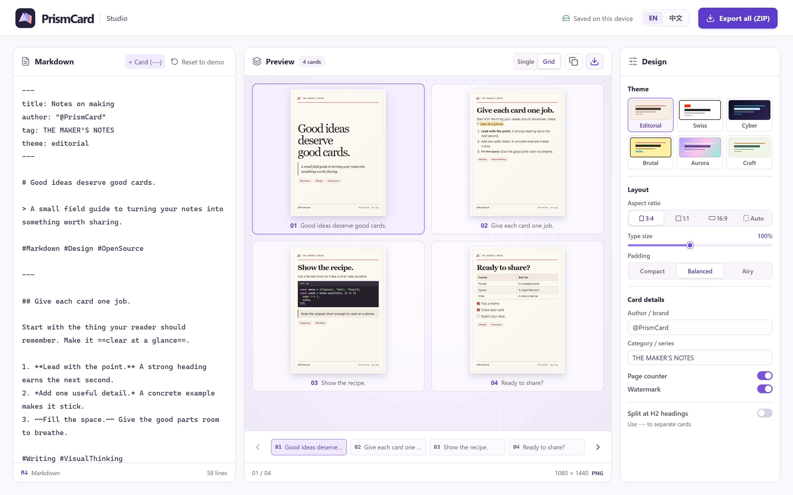
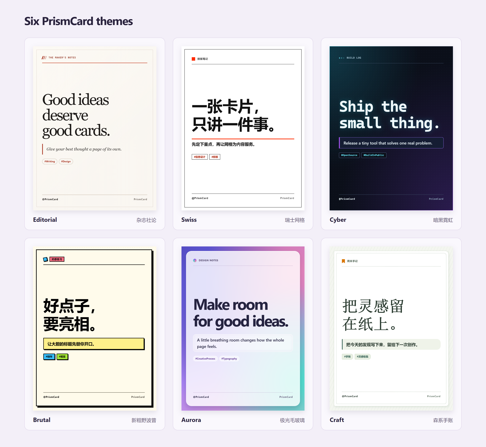

[English](./README.md) | [简体中文](./README.zh-CN.md)

# PrismCard

[](./LICENSE)


[](./skills/prismcard/SKILL.md)


Turn Markdown into a deck of high-resolution social cards. Design in the bilingual Web Studio or render from the command line with the same six themes. Both run on your device without a backend or API key.



## Interactive Web Studio

Open the [live PrismCard Studio](https://ttt759.github.io/prismcard/), or run locally with Node.js 20.19+ or 22.12+.

```sh
npm ci && npm run dev
```

1. Paste Markdown and use **+ Card (---)** to insert a separator at the cursor. Enable **Split at H2 headings** to start cards at level-two headings.
2. Switch between **Single** for a close look and **Grid** to review the whole deck. Select a card in either mode, then choose its theme, type size, padding, and card details in the design panel.
3. Download or copy the selected card as a 2× PNG, or use **Export all (ZIP)**. Copying images requires clipboard permission and HTTPS or localhost.

The editor soft-wraps long lines and saves the draft and settings in your browser. For a card that overflows, **Auto-fit** checks the selected card and applies compact spacing and the largest fitting type size down to 85% across the deck. **Use Auto height** keeps the full content at a fixed width.

| Aspect ratio | 2× PNG dimensions |
| --- | ---: |
| 3:4 portrait | 1080 × 1440 |
| 1:1 square | 1080 × 1080 |
| 16:9 wide | 1600 × 900 |
| Auto | 1080 px wide with content height |

## Six themes



| Theme | CLI value | Design |
| --- | --- | --- |
| Editorial | `editorial` | Ivory paper, serif headlines, vermilion rules |
| Swiss | `swiss` | Architectural grid, heavy type and red registration marks |
| Cyber | `cyber` | Dark terminal, dot matrix, cyan and violet light |
| Brutal | `brutal` | Pop-color badges, heavy borders and hard shadows |
| Aurora | `aurora` | Frosted glass over an indigo, rose and teal gradient |
| Craft | `craft` | Stitched paper, forest-green ink and an amber bookmark |

## Markdown cheatsheet

| Syntax | Result |
| --- | --- |
| `---` on its own line | Start a new card |
| `# Title` and `## Heading` | Cover title and section heading |
| `==highlight==` | Highlight a key phrase |
| `> quote` | Callout or subtitle |
| `- [x] Done` or `- [ ] Next` | Checklist item |
| Fenced code with a language | Syntax-highlighted code |
| Markdown table | Compact comparison or summary |
| `#Markdown #Design` at the end | Hashtag badges |
| Top YAML frontmatter | Set `title`, `author`, `tag`, and `theme` |

```markdown
---
title: Studio notes
author: "@example"
tag: FIELD NOTES
theme: editorial
---

# Notes from the studio

> One idea per card.

#Markdown #OpenSource

---

## Takeaways

- [x] Keep the title ==specific==.
- [ ] Export the deck.
```

Studio controls and CLI flags override frontmatter. Raw HTML appears as text, links appear as styled labels, and images display their alt text. Rendering runs without fetching remote content.

## AI Agent Skill and local CLI

Install the PrismCard skill from GitHub.

```sh
npx skills add ttt759/prismcard --skill prismcard
```

From the installed skill directory, run `npm ci` once, then invoke `node scripts/render-cards.mjs --input notes.md --out ./cards`. The skill bundles the renderer and uses system Chrome or Edge through Playwright. See the [skill guide](./skills/prismcard/SKILL.md) for card-writing rules and all CLI flags.

From the project repository, run:

```sh
npm run render -- --input notes.md --out ./cards --theme brutal --ratio 3:4 --lang zh --overwrite
```

The output contains numbered PNGs and `manifest.json` with the effective theme, ratio, language, and each card’s heading and pixel dimensions. `--overwrite` replaces the previous deck’s numbered PNGs and manifest, including stale numbered files from a longer deck.

## GitHub Pages deployment

In the GitHub repository, open **Settings → Pages** and set **Source** to **GitHub Actions**. A push to `main` or a manual run of the [deployment workflow](./.github/workflows/deploy.yml) tests the project, builds `dist/`, and deploys it. [GitHub Pages workflow documentation](https://docs.github.com/en/pages/getting-started-with-github-pages/using-custom-workflows-with-github-pages)

## Development

```sh
npm test
npm run build
npm run build:docs
npm run test:browser
```

`npm run build` type-checks the project and builds the Studio and bundled skill renderer. The docs and browser suites use an installed Chrome or Edge. After editing shared rendering code, commit the regenerated files in `skills/prismcard/assets/` and rebuild the screenshots if the visual output changed.
