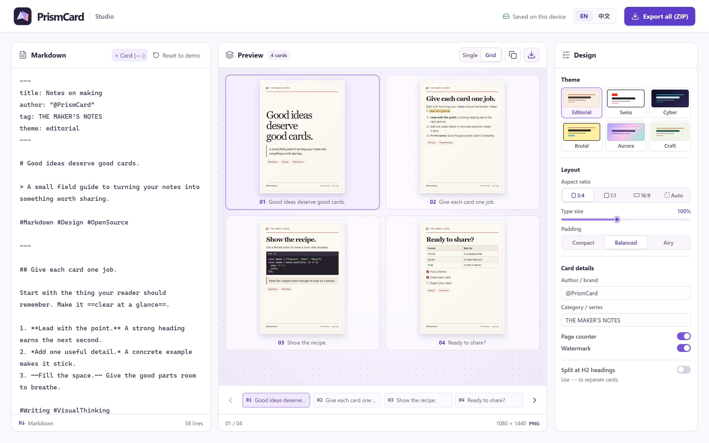
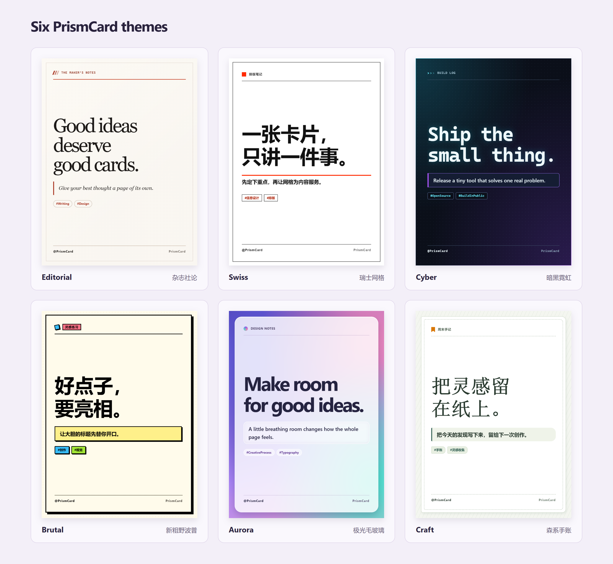

[English](./README.md) | [简体中文](./README.zh-CN.md)

# PrismCard

[](./LICENSE)


[](./skills/prismcard/SKILL.md)


把 Markdown 做成一组能直接分享的高清卡片。你可以在中英双语工作室里实时排版，也可以让 AI Agent 调用本地命令行渲染。两种模式共用六套主题，内容在本机处理，无需后端或 API 密钥。



## 网页工作室

在线打开 [PrismCard 工作室](https://ttt759.github.io/prismcard/)。本地运行需要 Node.js 20.19+ 或 22.12+。

```sh
npm ci && npm run dev
```

1. 粘贴 Markdown，点击 **+ 分卡 (---)** 在光标处插入分隔线。也可以开启 **按二级标题分卡**。
2. 用 **单张** 看细节，用 **网格** 检查整组。选择卡片后，可在设计面板调整主题、字号、留白和卡片信息。
3. 下载或复制当前卡片的 2× PNG，或点击 **导出全部（ZIP）**。复制图片需要剪贴板权限以及 HTTPS 或 localhost。

编辑器会自动换行，草稿和设置保存在当前浏览器。遇到超高卡片时，**自动适配** 会根据当前卡片计算可用的最大字号，最低降至 85%，并把字号和紧凑留白应用到整组。也可以一键 **使用自动高度** 保留完整内容。

| 宽高比 | 2× PNG 尺寸 |
| --- | ---: |
| 3:4 竖版 | 1080 × 1440 |
| 1:1 方形 | 1080 × 1080 |
| 16:9 横版 | 1600 × 900 |
| 自动 | 固定 1080 px 宽，高度随内容变化 |

## 六套主题



| 主题 | CLI 参数值 | 视觉特征 |
| --- | --- | --- |
| 杂志社论 | `editorial` | 暖象牙纸、衬线标题、朱红分隔线 |
| 瑞士网格 | `swiss` | 清晰网格、粗体标题、红色定位标记 |
| 暗黑霓虹 | `cyber` | 暗色终端、点阵、青紫发光边缘 |
| 新粗野波普 | `brutal` | 跳色标签、粗黑边框、硬阴影 |
| 极光毛玻璃 | `aurora` | 靛蓝、玫粉和青绿色渐变衬托磨砂面板 |
| 森系手账 | `craft` | 缝线纸张、深绿墨色、琥珀色书签 |

## Markdown 速查

| 写法 | 效果 |
| --- | --- |
| 单独一行 `---` | 分出一张新卡片 |
| `# 标题` / `## 小标题` | 封面标题和正文标题 |
| `==重点==` | 高亮短语 |
| `> 引用` | 摘句或封面副标题 |
| `- [x] 已完成` / `- [ ] 待办` | 任务清单 |
| 标注语言的围栏代码块 | 代码语法高亮 |
| Markdown 表格 | 对比或归纳要点 |
| 卡片末尾的 `#设计 #开源` | 话题标签 |
| 文件开头的 YAML 元数据 | 设置 `title`、`author`、`tag` 和 `theme` |

```markdown
---
title: 创作手记
author: "@example"
tag: 设计笔记
theme: editorial
---

# 一张卡，只讲一件事

> 把最值得记住的一句话留给读者。

#写作 #设计

---

## 发布前检查

- [x] 让标题==一眼就懂==。
- [ ] 导出卡片。
```

工作室设置和 CLI 参数优先于文件元数据。原始 HTML 按文字显示，链接以标签样式呈现，图片显示替代文字。渲染过程无需请求远程内容。

## AI Agent 技能与本地命令行

从 GitHub 安装 PrismCard 技能。

```sh
npx skills add ttt759/prismcard --skill prismcard
```

在技能安装目录首次执行 `npm ci`，随后运行 `node scripts/render-cards.mjs --input notes.md --out ./cards`。技能内置渲染器，并通过 Playwright 调用系统 Chrome 或 Edge。[分卡写作规则与参数说明](./skills/prismcard/SKILL.md)

也可以直接在项目目录运行：

```sh
npm run render -- --input notes.md --out ./cards --theme brutal --ratio 3:4 --lang zh --overwrite
```

输出目录包含编号 PNG 和 `manifest.json`。清单记录主题、比例、语言及每张卡片的标题和像素尺寸。`--overwrite` 会替换上一组编号 PNG 和清单，并清理较长卡组留下的多余编号文件。

## 部署到 GitHub Pages

在仓库里打开 **Settings → Pages**，将 **Source** 设为 **GitHub Actions**。推送到 `main` 或手动运行[部署工作流](./.github/workflows/deploy.yml)，即可自动测试、构建和部署 `dist/`。[GitHub Pages 官方说明](https://docs.github.com/en/pages/getting-started-with-github-pages/using-custom-workflows-with-github-pages)

## 开发与验证

```sh
npm test
npm run build
npm run build:docs
npm run test:browser
```

`npm run build` 会检查 TypeScript 并构建 Studio 和技能内的渲染器。生成文档图片和跑浏览器测试需要系统已安装 Chrome 或 Edge。修改共用渲染代码后，请提交重新生成的 `skills/prismcard/assets/`，并在视觉效果变化时更新展示图。
